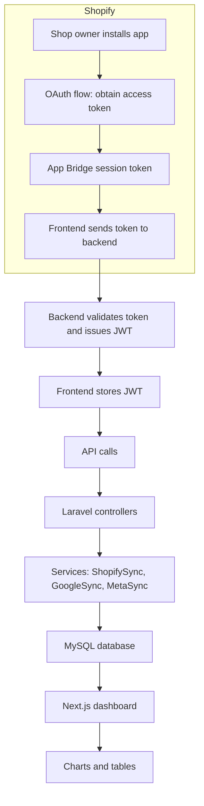

# Path-To-Profit – Shopify Analytics & Advertising Dashboard

## Overview

**Path-To-Profit** is a custom Shopify application that aggregates data from three major advertising and analytics platforms: **Shopify analytics**, **Google Ads**, and **Meta (Facebook) Ads**. It presents combined insights on a unified, interactive dashboard.

### What the app does

- **Shopify Data Collection**
  - Retrieves orders, products, customers, and traffic-source information directly from the Shopify store via the Shopify REST API.
  - Stores the data in a local MySQL database for querying and reporting.

- **Google Ads Integration**
  - Connects to a Google Ads account through OAuth and retrieves campaign spend, impressions, clicks, and conversion metrics.
  - Normalizes the data so advertising spend can be compared with Shopify revenue.

- **Meta (Facebook) Ads Integration**
  - Authenticates with the Meta Marketing API and retrieves ad-set spend, impressions, and results.
  - Aligns Meta ad performance with the same reporting periods used for Shopify orders.

- **Unified Dashboard**
  - Shows total revenue alongside Google and Meta advertising spend.
  - Compares cost per acquisition (CPA) across platforms.
  - Tracks channel performance, including organic, paid search, and paid social.
  - Visualizes trends across selectable date ranges, such as the last 7 days, month to date, or a custom range.
  - Provides drill-down tables for orders, products, customers, Google campaigns, Meta campaigns, and traffic sources.
  - Supports CSV and Excel exports for offline analysis.

### Key Features

1. **Data Sync** – Background jobs can run on demand or at a configurable interval (`SYNC_INTERVAL`).
2. **JWT Authentication** – The backend issues JWTs after validating a Shopify App Bridge session, allowing the frontend to call protected APIs.
3. **Scalable Architecture** – Laravel handles the API and queue layer, while the Next.js frontend provides a responsive application interface.
4. **Extensible Data Model** – Additional advertising platforms and metrics can be added by extending service classes and dashboard components.
5. **Role-Based Access** – Admin users can view all stores; store-specific users can only view data for their own shop.

## How It Works (Technical Flow)

## Credits & Contact

**Company:** Drunall Technologies

**Portfolio contact:** Jagdish Patidar — Founder & CEO

- [Drunall Technologies](https://www.drunall.com/)
- [Jagdish Patidar — Portfolio](https://jdpatidar.com/)
- [LinkedIn](https://www.linkedin.com/in/jdpatidar/)

For workforce management, attendance integration, payroll, or custom business software requirements, connect through the links above.
